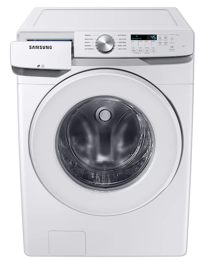
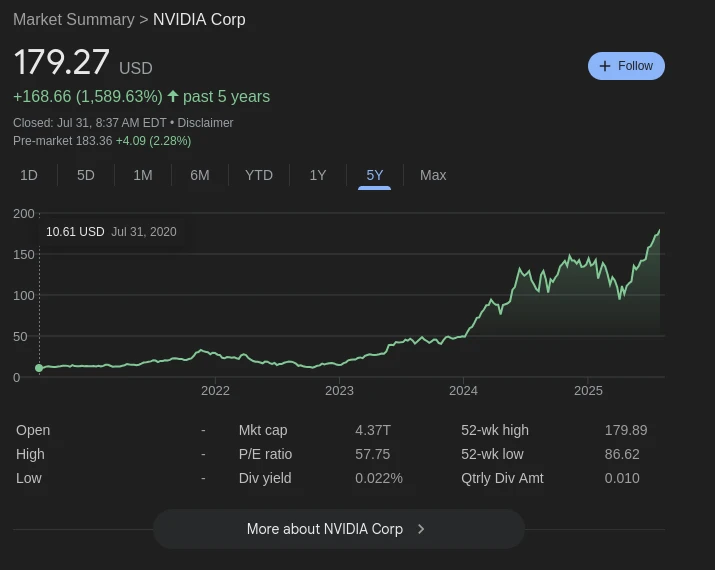

# Into to AI

Start off with a quick definition of "AI."
[What is 'AI'?](https://www.nasa.gov/what-is-artificial-intelligence/)

## Definition from Nasa

Artificial intelligence refers to computer systems that can perform complex tasks normally done by human-reasoning,
decision-making, creating, etc.

There is no single, simple definition of artificial intelligence because AI tools are capable of a wide range of tasks
and outputs, but NASA follows the definition of AI found within EO 13960, which references Section 238(g) of the
National Defense Authorization Act of 2019.

- Any artificial system that performs tasks under varying and unpredictable circumstances without significant human
  oversight, or that can learn from experience and improve performance when exposed to data sets.
- An artificial system developed in computer software, physical hardware, or other context that solves tasks requiring
  human-like perception, cognition, planning, learning, communication, or physical action.
- An artificial system designed to think or act like a human, including cognitive architectures and neural networks.
- A set of techniques, including machine learning that is designed to approximate a cognitive task.
- An artificial system designed to act rationally, including an intelligent software agent or embodied robot that
  achieves goals using perception, planning, reasoning, learning, communicating, decision-making, and acting.

[What is AI Vide](https://www.youtube.com/watch?v=a0_lo_GDcFw&t=54s)

## No Body says robot

What is a washing machine?
It's a cloth cleaning machine.

vs

When something becomes command we stop calling it a robot.
Same thing with AI.
Your phone camera uses very complex code to process photos

### Everyone Says AI?

Company's won't stop saying "AI".

- [Video of Samsung Unpacked Event 2025](https://www.youtube.com/watch?v=UyyYbl0huC4)
    - [Local Copy](assets/Samsung Unpacked 2025 But It's Just ＂AI＂.webm)

Why does no one say robot BUT everyone is saying "AI"?
Well its making the shovel sellers rich (explain the gold rush and the shovel sellers).

[Link to live stock](https://investor.nvidia.com/stock-info/stock-quote-and-chart/default.aspx)

AI is not going away, and it's going to change a lot.
Just wanted to tamper some hype.
Now lets go so some cool stuff with AI.

## Activity

Set up Learning Journal.

Each lecture day you will write in your Learning Journal.
The last part of today's lecture is setting you up to write in your journal.
You will turn this journal in each unit.
