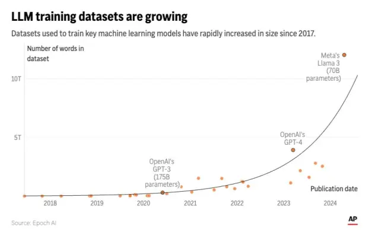

# Ethics

Today we are going to talk about the many ethical problems with AI.
We will just scratch the surface of this issue today.

## Power Usage

The interest uses a lot of power. Well its less then a letter the tech that pre existed
it [source](https://www.sciencefocus.com/planet-earth/the-thought-experiment-what-is-the-carbon-footprint-of-an-email).
But AI uses much, much more.

Watch: https://www.youtube.com/watch?v=DGjj7wDYaiI

## Data Theft

When building AI you need data.

- They need virgin data, and they are running out of it: https://www.dataprovenance.org/consent-in-crisis-paper
  
- So they stole the internet.
    - Stole the YouTube Videos: https://www.wired.com/story/youtube-training-data-apple-nvidia-anthropic/
    - Stole the
      books: https://www.nbcnews.com/tech/tech-news/federal-judge-rules-copyrighted-books-are-fair-use-ai-training-rcna214766
- Why can't I pirate a single book but AI can pirate them all.

## Bias

People are biased. Everyone has their own preconceived notations.
Since AI is made by people it also has bias.

- Share story about Twitter Cropping based on race: https://arxiv.org/pdf/2105.08667
- Phone cameras have smaller sensers but take good photos how? Well fancy algorithms (AI) to enhance them. Sometimes
  these algorithms do not work the same with all peoples skin tones (My wife can
  contest): https://store.google.com/intl/en/ideas/real-tone/
- AI is biased always no mater how suttle.
    - Tay Chat bot on Twitter (2016): https://en.wikipedia.org/wiki/Tay_(chatbot)
    - Grok Chat bot on Twitter (
      2024-now): https://www.npr.org/2025/07/09/nx-s1-5462609/grok-elon-musk-antisemitic-racist-content

https://www.ibm.com/think/topics/ai-bias

## AI Psychosis

- https://www.nytimes.com/2025/08/08/technology/ai-chatbots-delusions-chatgpt.html
- https://futurism.com/artificial-intelligence/meta-ai-glasses-desert-aliens
- Warning content may be NSFW: https://www.reddit.com/r/MyBoyfriendIsAI/
    - Give a warning that you are not poking fun of these people. Only that we are worried about the mental health of people who are so attached to AI.

