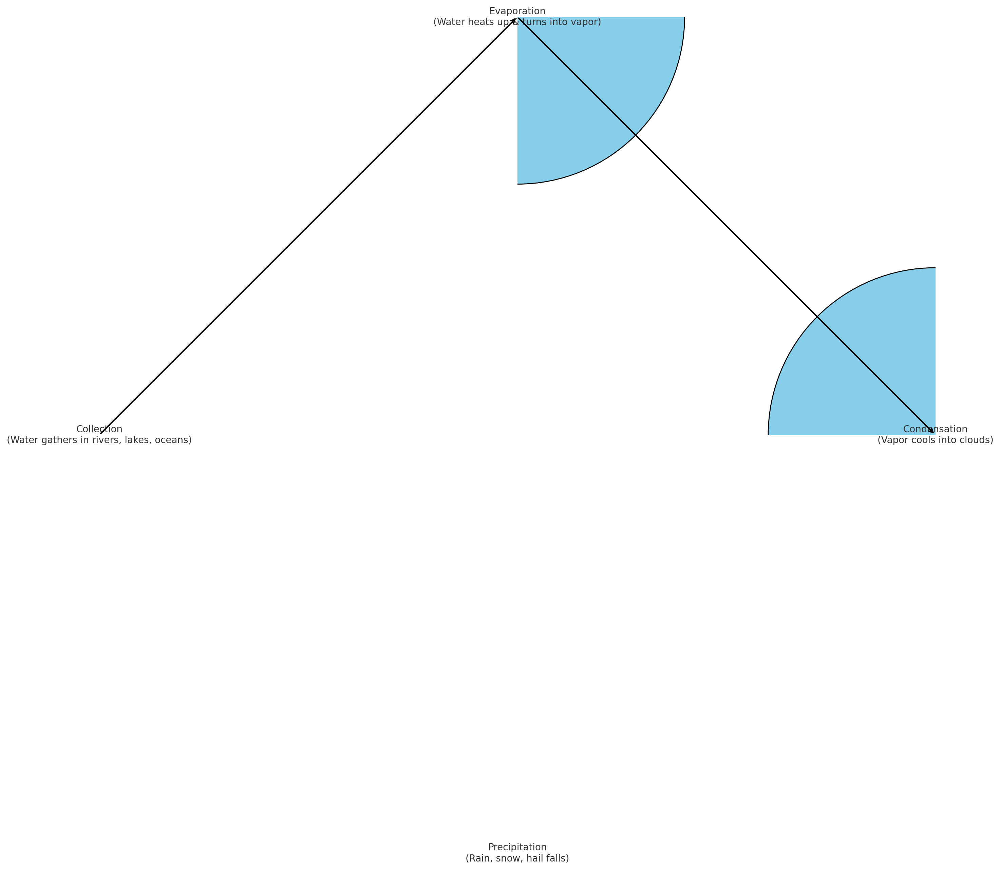
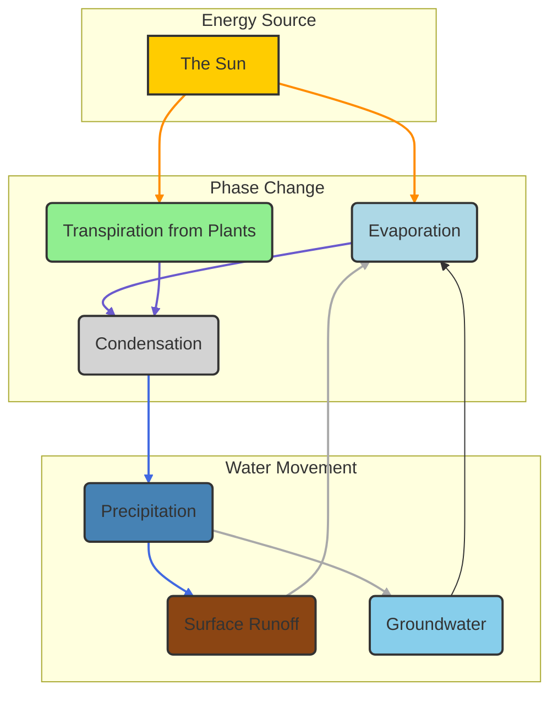

# Prompting

## Learning Journal

If students haven't already spend class time uploading their learning journals to their git repositories.

Instructions: https://github.com/IHCC-AI/Learning-Journal

## Prompt Engineering

What is prompt engineering?

- [AWS prompt engineering techniques](https://aws.amazon.com/what-is/prompt-engineering/)

[Googles Course Free with Credit Card](https://www.coursera.org/specializations/prompting-essentials-google)

- Video About the course: https://www.youtube.com/watch?v=OQaTkeAj8UU
  Video summarizing the course: https://www.youtube.com/watch?v=0Kr1eh1wwb8

## Your holding it wrong

Now prompt engineering helps a lot.
But some people use it as an excuse when you show flaws in the AI future.
They will say "Your prompting it wrong".
While that might be true most likely its just...

[Your Holding it wrong](https://uxdesign.cc/youre-holding-it-wrong-how-to-blame-the-user-6ebfd36f5664)

## Prompt Framework

- Task
    - Persona (who the AI is) ie marketer, teacher
    - Format: Output type
- Context
    - Good: Give me some ideas for a birthday present **under $30.**
    - Great: Give me 5 ideas for a birthday present. **My budget is $30. The gift is for a 29-year-old who loves winter
      sports and has recently switched from snowboarding to skiing.**
- Reference
    - Additional input data, ideas
- Evaluate
    - See if the output is what you needed
- Iterate
    - If the code has an error feed it back into the ai
    - Add more information.

## Always be Iterating

If things don't work out try these things to get better results.

1. Revisit the prompting framework.
    - Mark up your prompt into T-C-R
        - T: Make a schedule for Luke, Susan and Mitziu output a CSV.
        - C: Luke has class this class schedule...
        - R: Class schedules in the past.
2. Separate your prompt into shorter tasks (great for coding).
    - Monolithic:
      `Summarize the key data points and information in this report. Then create visual graphs from the data, and shorten the key information into bullets.`
    - Tasks:
        - `Summarize the key Data Points`
        - `Create visual graphs with the data you summarized`
        - `Shorten key information you summarized into bullets`
3. Trying different phrasing or switch to an analogous task
    - Analogous: similar task just different enough to trigger a different response.
    - `Write a marketing plan`
    - vs
    - `Write a story about how this product fits into the lives of our target customer demographic`
4. Introduce Constraints
    - `Only play music from canida` or `recipies that only take 30m`.

## Demo 1 How to make good prompts

The importance of specificity, context, and persona.

- Demo making a diagram of weather cycle with mermaid without and then with context

### No context

```prompt
Make a diagram of weather cycle.
```



### With context

```prompt
You are a 5th grade teacher and need to teach your students the weather cycle.
Make sure you include; Precipitation, surface runoff, groundwater, respiration (plants) / evaporation, condensation.
Generate a age appropriate diagram of the weather cycle using mermaid diagram.
Output the diagram in valid text that would generate a diagram so i can edit it.
```

Example output:



If the diagram is wrong copy the error back into the AI. If it is correct make a new chat and break the diagram and get it
to fix it. You can't use "(" in labels if it tries to do that.

The human-AI partnership: The AI is a tool, not a replacement.

## Demo 2

## Activities

[Say What You See](https://artsandculture.google.com/experiment/jwG3m7wQShZngw?ref=campaigntrend.com)
