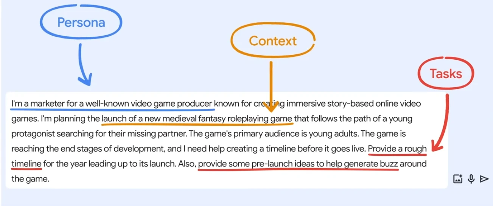

# Getting AI To work

Remember "Garbage In, Garbage Out"

## Demo 1 Writing an Email

```
I'm a gym manager and we have a new gym schedule.
Write an email informing our staff of the new Schedule.
Highlight the fact the the M/W/F Cardio Blast class changed from 7:00am to 6:am.
Make the email professional and friendly, and short so that readers can skim it quickly.
Here is the new schedule: 
```

I think gemini is best for this.
Copy in this [Schedule](assets/schedule.csv) to the end of the prompt.
After first go, iterate by changing the tone.

```
Now write a concise, consumer-facing email with this same information. 
Exmplain that this new schedule will help us better serve them.
Make the tone fun, friendly.
Include a pun about lifting weights.
```

## Demo 2 Video game roadmap

```
I'm a marketer for a well-known video game producer known for creating immersive story-based online video games.
I'm planning the launch of a new medieval fantasy roleplaying game that follows the path of a young protagonist searching for their missing partner.
The game's is reaching the end stages of development, and I need help creating a timeline before it goes live.
Provide a rought timeline for the year leading up to its launch.
Also, provide some pre-launch ideas to help generate buzz around the game.
```

Mark up the prompt like so.



Follow up.

```
Now provide pre-launch ideas that will appeal to a global audience of young adults.
```

## Demo 3 Schedule

Use gemini so you can open the output in google sheets.

```
I have 10 employees.
Their employee numbers are 1-10.
Create a table that tracks weekly staffing.
Create columns for day, name, and shift (morning or afternoon).
- There should always be 2 employees scheduled morning and afternoon shifts
- Employees should not be scheduled for a morning shift on the following day after they were scheduled for an afternoon shift. 
- Shifts should be roughly equal across employees. 
```

> Note: Whose computer has access now to your employees schedule?
> Is it ok to include personal information into AI not consulted by you?

## In class Activity

Do Messy Data Pair Programming Assignment In class. 
