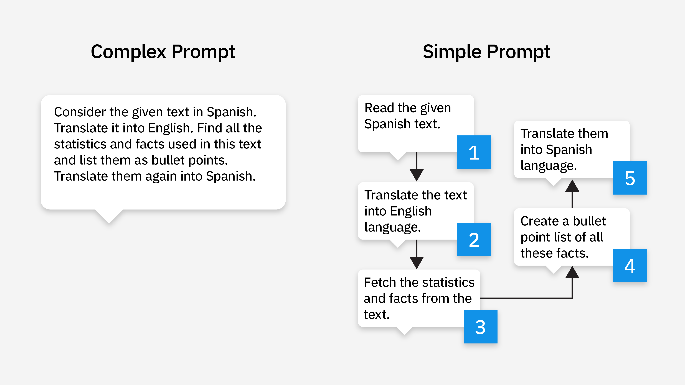
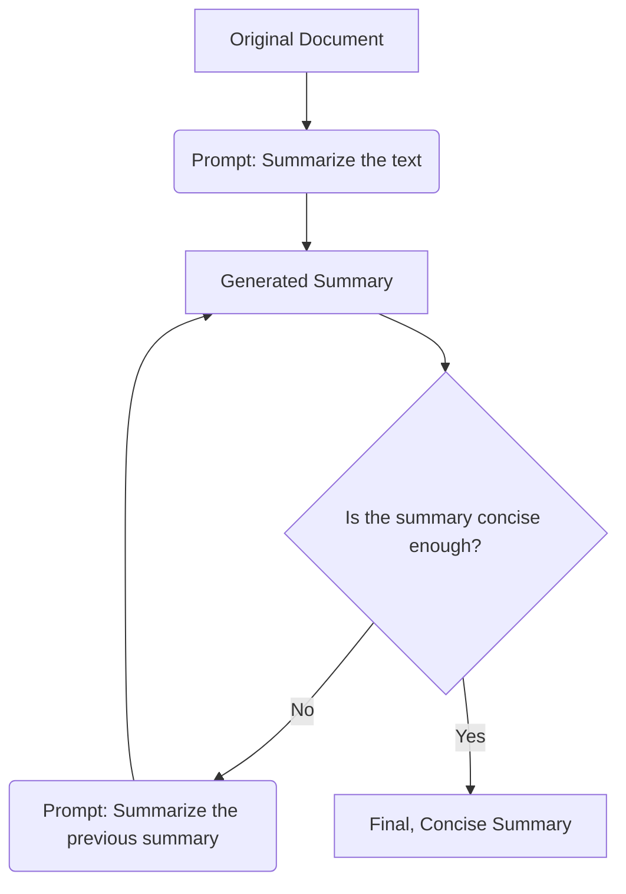

# Summaries and using AI as an Export Partner

Using AI to untangle complex tasks: 

- Turn abstract ideas into solutions
- Create AI Agent
- Build a prompt Library. 

## AI Summary's could not be safe. 

https://www.bleepingcomputer.com/news/security/google-gemini-flaw-hijacks-email-summaries-for-phishing/

## Demo 1:Summarize Manuscript

This is an example of prompt chaining. 



[//]: # (TODO)
Use the [attached]() manuscript.

```
Generate three options for a one-sentence summary for a novel manuscript.
The summary should be similar in voice and tone to the manuscript but more catchy and engaging. 
```

Refine the output

```
Create a tagline that is combination of the previous three options.
With a special focus on the exciting plot twists and mystery of the book.
Find the catchies and most consise and leave the reader the most hooked to read more
```

## Chain of thought

Asks AI to explain how it got to it's answer (it can lie). 
Example: `exmplain your how you got to your solution`.
[What is chain of thought (CoT) prompting? ](https://www.ibm.com/think/topics/chain-of-thoughts)

## Chain of density

Reduce -> Reduce -> reduce
If you try to one shot reducing/summarising text you might loss some of the most important ports. 
So try to do it in steps. 



## Chain of Density Demo 

[//]: # (TODO build demo)


## Activity: Summarize large amounts of data

[//]: # (TODO pick a smaller report mabye)
[//]: # (TODO Make and give example prompts to studnets)

Use chain of density to break down the [IPCC AR6 Synthesis Report](https://www.ipcc.ch/report/ar6/syr/downloads/report/IPCC_AR6_SYR_SPM.pdf)


