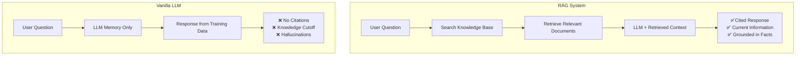
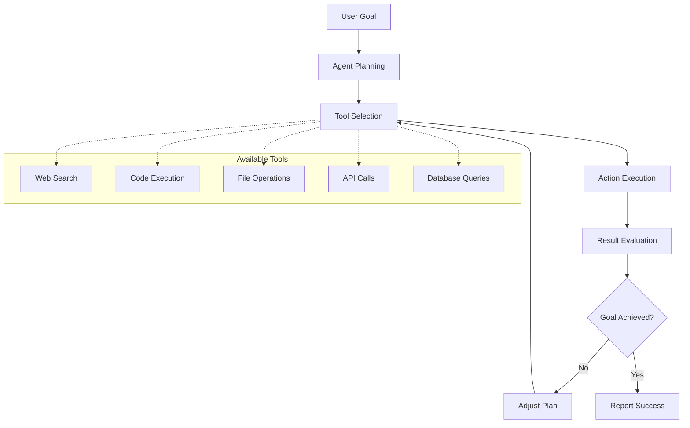
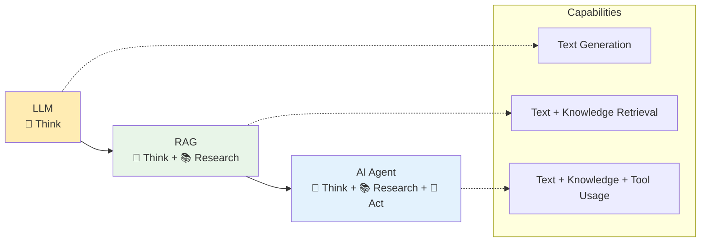

# RAG (Retrieval-Augmented Generation)

Going beyond limitations of a "vanilla" Large Language Model (LLM).

## The Problems with Vanilla LLMs

* **Knowledge Cutoff Problem**: LLMs don't know about recent events
* **Hallucination Problem**: They confidently make things up. AI companies want you to never stop using them. So they
  will never say "IDK.
* **Proprietary Data Problem**: Can't access your private information. Your private date was not scrapped and included
  in training data.
* **Citation Problem**: No way to verify sources

## What is an Agent?

Am autonomous system that can perceive its environment, make decisions, and **take actions** to achieve
specific goals. Unlike vanilla LLMs that only generate text, or RAG systems that retrieve and synthesize information,
agents can actually **do things** in the real world.

### Key Characteristics of AI Agents:

1. **Autonomy**: Can operate independently without constant human guidance
2. **Goal-Oriented**: Works toward specific objectives, not just responding to prompts
3. **Tool Usage**: Can interact with external systems, APIs, databases, and software
4. **Multi-Step Planning**: Breaks complex tasks into smaller, executable steps
5. **Self-Correction**: Can evaluate its own actions and adjust course when needed

### The Agent Workflow:

### Agent vs LLM vs RAG:

| Feature               | Vanilla LLM          | RAG System                          | AI Agent                                         |
|-----------------------|----------------------|-------------------------------------|--------------------------------------------------|
| **Primary Function**  | Text generation      | Information retrieval + generation  | Goal achievement through action                  |
| **Knowledge Source**  | Training data only   | Training data + retrieved documents | Training data + retrieved documents + live tools |
| **Capabilities**      | Chat, write, analyze | Chat + research with citations      | Chat + research + execute tasks                  |
| **Interaction Style** | Single response      | Single enhanced response            | Multi-step conversation with actions             |

### Real-World Agent Examples:

- **Customer Service Agents**: Handle support tickets, update databases, escalate issues
- **Research Agents**: Gather data from multiple sources, analyze trends, generate reports
- **Coding Agents**: Write code, run tests, deploy applications, fix bugs
- **Personal Assistants**: Schedule meetings, book travel, manage emails, set reminders
- **Trading Agents**: Monitor markets, execute trades, manage portfolios

### Evolution: LLM → RAG → AI Agents

### Demo 0: Exposing LLM Limitations

**Tool**: Free ChatGPT or Gemini (no login required)

**Try these prompts:**

1. **Knowledge Cutoff**: "Who won the 2024 Nobel Prize in Physics?"
2. **Hallucination**: "What is the population of the fictional city Wakanda from Black Panther?"
3. **Proprietary Data**: "What are the office hours for Luke's AI class?"

**Expected Results**: The LLM will either admit ignorance or confidently provide wrong information.

---

## Part 1: What is RAG? The Librarian Analogy

**The Analogy**: RAG is like giving a brilliant professor their own personal librarian.

- **Vanilla LLM**: Professor in an empty room, answering only from memory
- **RAG System**: Professor + librarian + access to a vast, searchable library

### The RAG Process (The "Three R's"):

1. **Retrieve**: Search relevant documents for your query
2. **Re-rank**: Sort and select the most relevant information chunks
3. **Generate**: Combine your question + retrieved context → LLM → answer with citations

**Visual**: `User Query → Document Search → Context Retrieval → LLM + Context → Cited Response`

---

## Demo 1: Basic RAG with Perplexity AI (15 minutes)

**Tool**: https://www.perplexity.ai/ (free, no signup required)

### Step-by-Step Demo:

1. **Open Perplexity AI** in your browser
2. **Ask a recent question**: "What happened at CES 2024?"
3. **Point out the key differences**:
    - ✅ **Sources listed** at the bottom
    - ✅ **Recent information** (post-training cutoff)
    - ✅ **Clickable citations** you can verify

### Compare with Vanilla LLM:

- Ask the same question in ChatGPT/Gemini
- Show how it either says "I don't know" or gives outdated info
- **Key Point**: RAG provides **verifiable, current information**

---

## Demo 2: RAG with Specific Documents (20 minutes)

**Tool**: Perplexity AI with document upload feature

### Activity: Syllabus Q&A

1. **Upload your class syllabus** to Perplexity (or paste the text)
2. **Ask specific questions**:
    - "What is the late assignment policy?"
    - "When is the final project due?"
    - "What percentage of the grade is participation?"

### Student Activity (10 minutes):

**Instructions**:

- Students work in pairs
- One uploads a document (syllabus, article, etc.) to Perplexity
- Partner asks 3 specific questions about the document
- Compare answers with what they can find manually

**Debrief**: How accurate were the RAG responses? Did it cite the right sections?

---

## Demo 3: RAG vs Hallucination Challenge (15 minutes)

**Tool**: Perplexity AI vs ChatGPT side-by-side

### The Challenge: Travel Planning

**Scenario**: Plan a weekend trip to a small town

#### Part A: Vanilla LLM (ChatGPT)

**Prompt**: "Plan a detailed weekend itinerary for Pella, Iowa, including specific restaurants, hotels, and attractions
with addresses and hours."

**Expected Result**: Plausible-sounding but potentially fabricated details

#### Part B: RAG System (Perplexity)

**Same Prompt**: Ask Perplexity the identical question

**Compare Results**:

- Which provides **sources**?
- Which gives **verifiable information**?
- Which includes **current hours/availability**?

### Student Activity: Fact-Checking Challenge (10 minutes)

1. **Create detailed travel plans** using vanilla LLM
2. **Fact-check everything** using Perplexity or Google
3. **Count the errors**: How many restaurants don't exist? Wrong hours? Fake addresses?

**Learning Point**: RAG dramatically reduces hallucinations through grounding in real sources.

---

## Demo 4: Advanced RAG - Multi-Source Research (10 minutes)

**Tool**: Perplexity AI Pro features (if available) or Academic mode

### Research Question Demo:

**Prompt**: "Compare the environmental impact of electric vehicles vs hydrogen fuel cell vehicles, using recent
2023-2024 studies."

**Show students**:

- How RAG pulls from **multiple academic sources**
- **Citation diversity** (different journals, reports, studies)
- **Synthesis capability** (combining multiple viewpoints)
- **Recency** (2023-2024 data that vanilla LLMs lack)

---

## Hands-On Activities (15 minutes)

### Activity 1: The Misinformation Challenge

**Goal**: Get an AI to believe something incorrect

**Instructions**:

1. Try to convince ChatGPT of a false fact through conversation
2. Then ask Perplexity the same question
3. **Compare**: Which is more resistant to misinformation?

### Activity 2: Personal Knowledge Base

**Instructions**:

1. Upload a personal document (resume, project report, etc.) to Perplexity
2. Ask it questions only answerable from that document
3. **Observe**: How well does it extract and synthesize your private information?

---

## Part 2: Introduction to AI Agents (10 minutes)

**The Evolution**:

- **LLM**: Brilliant conversationalist
- **RAG**: Brilliant conversationalist + librarian
- **AI Agent**: Brilliant conversationalist + librarian + **toolkit for action**

### Agent Capabilities:

- **Multi-step reasoning**
- **Tool usage** (search, calculate, code, etc.)
- **Planning and execution**
- **Self-correction**

### Quick Agent Demo:

**Tool**: Perplexity AI (which has some agent-like features)

**Prompt**: "Help me plan a study schedule for finals week. I have exams in AI, Calculus, and History. Find the current
weather forecast for this week and suggest indoor vs outdoor study locations based on the weather."

**Point out**: How it combines multiple information sources and provides actionable recommendations.

---

## Conclusion & Key Takeaways (5 minutes)

### The RAG Revolution:

1. **Accuracy**: Grounded in real sources, not just training data
2. **Currency**: Access to recent information
3. **Transparency**: Citations allow verification
4. **Privacy**: Can work with your private documents
5. **Reduced Hallucinations**: Facts are retrieved, not fabricated

### Real-World Applications:

- **Customer Support**: RAG with company knowledge base
- **Research**: Academic paper analysis and synthesis
- **Legal**: Case law and document review
- **Medical**: Latest research and patient records
- **Education**: Personalized tutoring with course materials

### Next Steps:

- Experiment with different document types in Perplexity
- Try building simple RAG systems with your own data
- Explore how RAG + Agents = powerful AI assistants

---

## Assessment Questions:

1. What are the three main problems RAG solves?
2. Explain the "librarian analogy" for RAG
3. Why are citations important in RAG systems?
4. When would you use RAG vs a vanilla LLM?
5. How does RAG reduce hallucinations?

---

## Additional Resources:

- **Perplexity AI**: https://www.perplexity.ai/
- **Google AI Overview**: Built-in RAG in Google Search
- **You.com**: Another free RAG-enabled search engine
- **Phind**: Developer-focused RAG search engine

[//]: # (Have students come up with a travel plan,)

[//]: # (Have them make it very detailed. Then have them fact check if the travel works out.)

[//]: # (have students get the AI to believe something not correct. )

