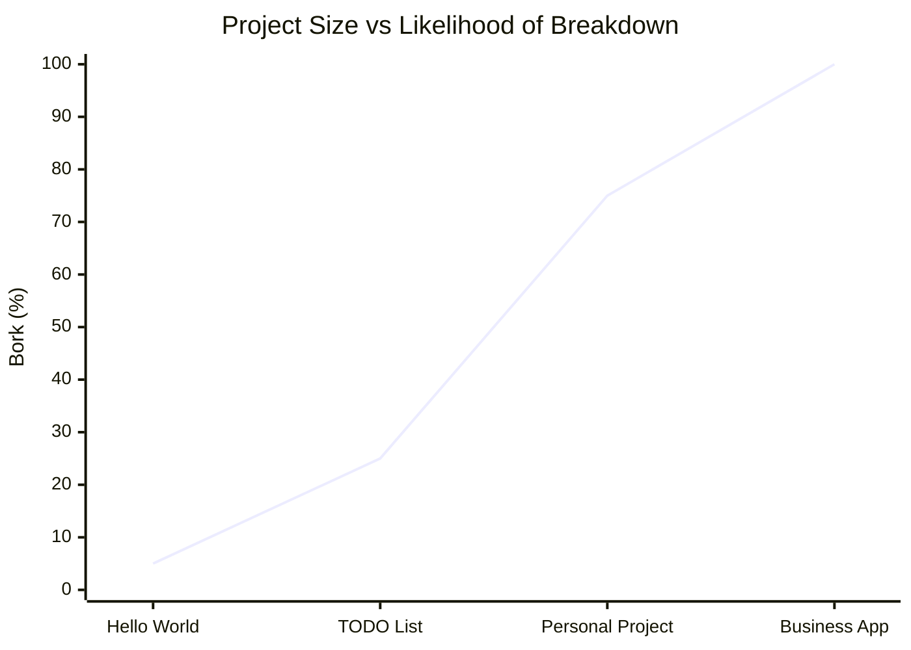
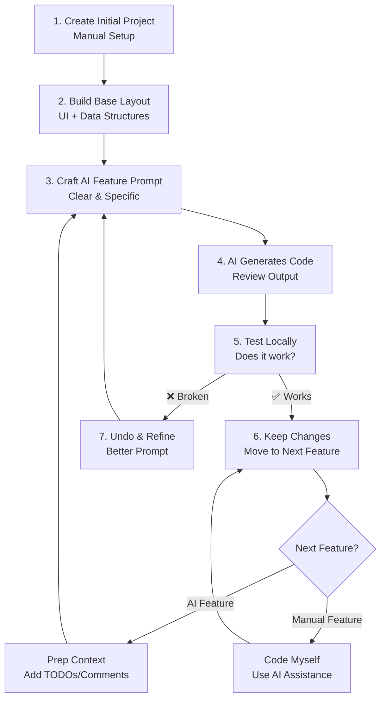

# Using AI To add Features to Projects

Today we will look at bigger projects and try to add a feature to the project.

## Cold Open

[The "vibe coding" mind virus explained](https://www.youtube.com/watch?v=Tw18-4U7mts)

Now lets go make some mistakes.

## AI IDE

Download (Linux/Mac) Only [Zed](https://zed.dev/download).

- Windows version is still being
  developed. [Blog post here about development](https://zed.dev/blog/windows-progress-report).

## Get the Starter Code

Download from Blackboard.
Open in IDE.
Project: Cookie Clicker
Show students the cookie clicker game: https://orteil.dashnet.org/cookieclicker/

## Demo 1

Let's add better style and website layout to our app.
Have students copy the following code into AI (or Zed).
And then have them prompt the AI with the following prompt:

```
To the Cookie Clicker App add a Header and footer. Add Tailwind CSS.
- For the header add the name of the game "Cookie Clicker" and a logo
  - Just below the header add a navigation bar with links to the different pages
- For the footer add a link to the source code and social media links
- Style the app with Tailwind CSS CLI "PLay CDN" I do not want to use a framework or a node libaray. 
    Just link tailwind with a script in the header. Style the app like the official cookie clicker game. 
    Example `<script src="https://cdn.jsdelivr.net/npm/@tailwindcss/browser@4"></script>`
```

Refine the code to make it work.
The AI will most likely make the following mistakes:

- Fake Image links
- Try to use Tailwind though a framework or a node library
- Add extra features we didn't ask for.

## Demo 2

Now that we have a better layout and style, let's add some features to the app.
New Feature : Add a way to buy grandmas.

In the cookie clicker game the user doesn't want to click the cookie forever.
So we get grandma's to click it for us.

Make sure the AI has our code from Demo 1 and starter code.

```
Now we have the central game loop of the user being able to click the cookie I want to add the ability to buy grandmas.
Each grandma should cost 100 cookies and passivity generate 1.0 cookies per second. 
Add a UI to buy the grandma. And an output of the users cookies per second passive generation. 
Make sure code added is modular and uses modern js best practices.
Add to the current project don't use any frameworks. Just normal JS. 
```

### Refine

- Fix bugs.
- Start the cookies at 100 for testing.

## Demo 3

Feature: Achievement system

```
Add an achievement system. Create achievements for common milestones like:
- Click Achievements: "First Click" (1 click), "Cookie Novice" (100 clicks), "Cookie Expert" (1,000 clicks)
- Building Achievements: "Grandma's Helper" (buy 1 grandma), "Grandma Army" (buy 10 grandmas)
- Cookie Achievements: "Sweet Start" (earn 100 cookies), "Cookie Millionaire" (earn 1,000,000 cookies)
- Production Achievements: "Passive Income" (reach 10 cookies per second), "Cookie Factory" (reach 100 cookies per second)

Each achievement should:
- Award bonus cookies when unlocked (10-500 cookies depending on difficulty)
- Show a notification popup when earned
- Display in a dedicated achievements panel with progress bars for incomplete ones
- Use icons or emojis to make them visually appealing
- Track progress automatically and check for completion after each game action

Make the system modular so new achievements can be easily added later. 
Add a button to toggle the achievements panel visibility.
```

### Does it still work

Go around the room and see the end product.
See how as the project gets bigger the likelihood the project goes down.
This all changes weather you are in the driving seat or the AI is. 



Things I had to fix in my finished project.
- Fake methods being called. 
- Links to images. 
- What did you have to fix?

## My AI Development Cycle

Example: Cookie clicker

1. Create init project my self (Easy and saves a LOT of tokens).
   - For example Svelte Project `npx sv create my-app`
2. Getting Base: Create Layout of project by hand.
   - UI Layout
   - Date Structures
   - OOP Classes
3. Ask the AI to add a Feature
    - Create Empty methods/part of the UI placeholder so AI has context on how I want it built.
    - Add comments TODO message for context (This is cheaper than a long prompt)
    - Make a perfect prompt (a Bad prompt can waste a LOT of money)
    - Keep the feature simple. You can always add on later. Biting off too much can waste time. 
4. Test the feature myself locally.
5. Un-do the AI code and Refine the prompt if necessary 
6. Add my own features or prep for another AI Feature
    - If I want to add a feature myself (very simple/or AI is not a good fit)
      - I might use AI for part of the feature
      - I use an IDE with AI line completion
      - I might ask AI questions or help if I get stuck. 
    - If I want AI to add the feature I go back to step 3.



## Assignment 

Make students turn in their cooke clicker game. 