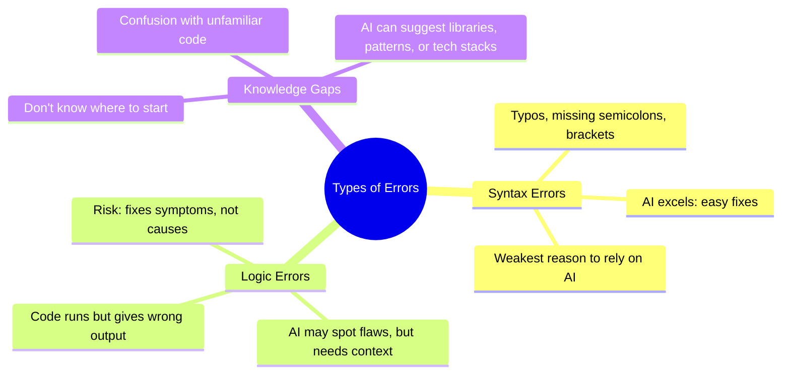

# Using AI to Debug Code

In this lecture we will feed AI our broken code and have the AI try to fix it.  
Examples are in HTML/CSS/JS (no framework).

## Motivation

Why would you use AI to debug code?

- Faster iteration: AI can often spot common errors in seconds that might take a human minutes or hours.
- Learning aid: Students can see *why* code is broken, not just that it fails.
- Idea generation: Sometimes AI suggests alternative approaches you may not have considered (avoid the bug).
- Productivity multiplier: AI doesn’t get tired of repetitive debugging tasks.

Transition: But before we get too optimistic

## Pitfalls

- AI is Lazy
    - Often deletes or disables code instead of truly fixing it.
    - Can produce “solutions” that look clean but break hidden functionality.
    - 
        - Example of AI “fixing” things by turning them off

- AI will invent things
    - Makes up libraries, methods, or APIs that don’t exist.
    - [YT SHORT about this](https://www.youtube.com/shorts/2p7USa-PS9U)

- AI and Security/Privacy Concerns
    - Copy/pasting proprietary code into AI tools may expose trade secrets.
    - Some AI may log or use data for retraining.
    - Developers must balance usefulness with confidentiality.
    - You can mitigate most of this by running FOSS models locally.

Transition: So, what kinds of problems is AI actually good at fixing?

## Types of Errors

[//]: # (Draw a digram while explaining this based on text below)

### Syntax Errors

- Missing semicolons, brackets, or typos.
- AI excels here because patterns are obvious and repetitive.
- If you need help with syntax... I'm going to be honest you should be programming.
    - Or at least understand if syntax is the barrier just know AI will always be in the driving seat.
- I think this is the weakest excuse to use AI.

### Logic Errors

- Code compiles, but does the wrong thing.
- AI may catch common logical flaws, but needs context.
- Risk: AI might “fix” the symptom without addressing the cause.
- Most of the time when I try this AI is not very useful.

### Knowledge Gaps

- Developer doesn’t know where to begin.
- Confusion over code written by someone else
- AI can suggest technologies or patterns.
- AI can suggest tech stacks.
- AI can point you in a different directions that might be much easier.

## Exercise 

Project: Simple RPG item Shop with checkout

Items for sale: 
- Heath potion: 100g
- Horse Armor: 1050g
- Sweet roll: 10g

Pages: 
- Store page
  - List of items
- Check out screen
  - List the items bought and quantity
  - Total
  - Make sure enter there rpg inspired payment methods
- Order conformation screen with summary

### Demo 1: Fix Syntax

### Demo 2: Fix Logic

### Demo 3: Explain the Problem

## Discussion: When to Trust AI?

- When debugging small, brainstorming (no code changes) ,obvious problems, → high trust.
- When AI suggests new solutions → low trust until verified.
- When stakes are high (security, production) → never blindly trust.

