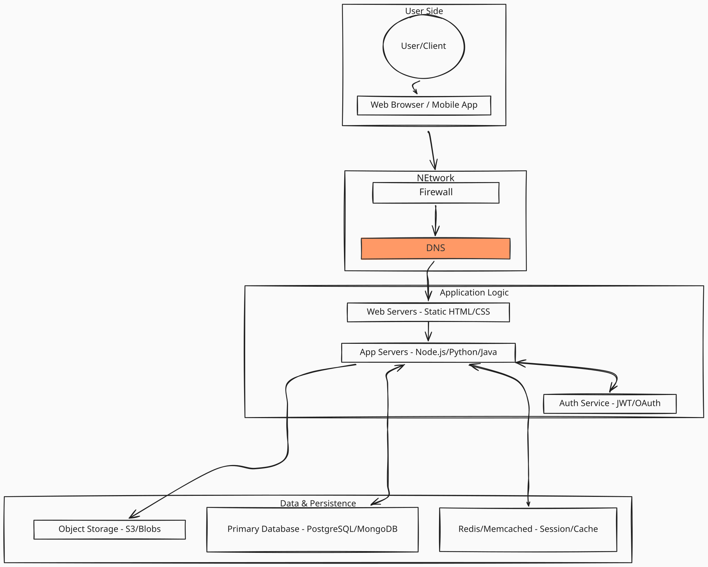
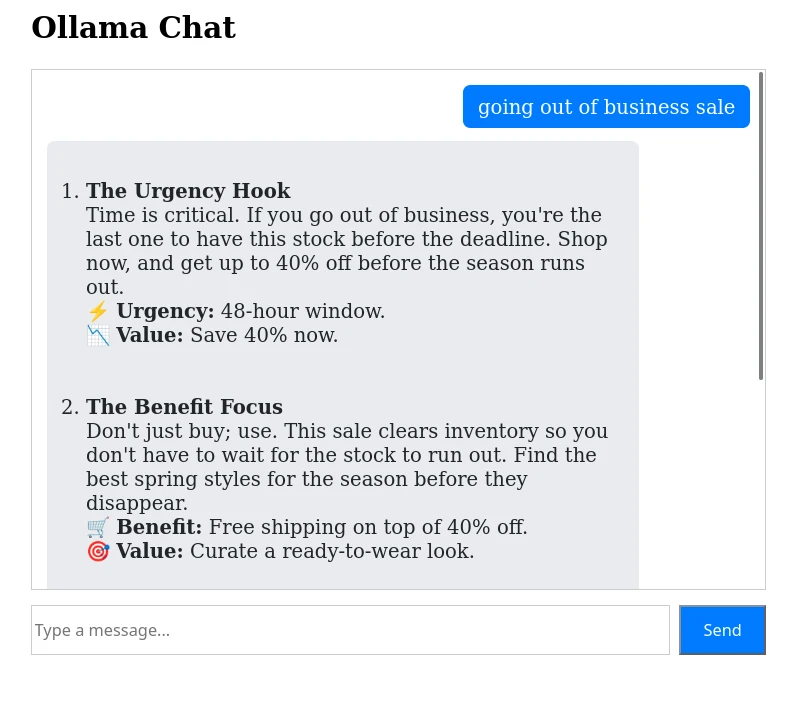

# Consuming AI

Yesterday we "created" our own AI model. Today we will "consume" it by building a simple web application that uses our model to generate email content.

Building this lecture was difficult because you all are at different levels of experience. So I drew the line at "you should understand basic client server architecture"

## Review Client Server Architecture

> This diagram was created for the Beginning Web Development course.

## Build a client

We will build a simple client using HTML/CSS/JS.
More complex clients can be built using what is called a "framework".

- [Client Code](../../LU05%20Deploying%20AI/L3-FrontEnd/AIClient/AIClient.html)

Make sure to change the model name in the code.

> You **need** to run the client using a local server like "Live Server" in VS Code. You **cannot** just open the HTML file in your browser.
