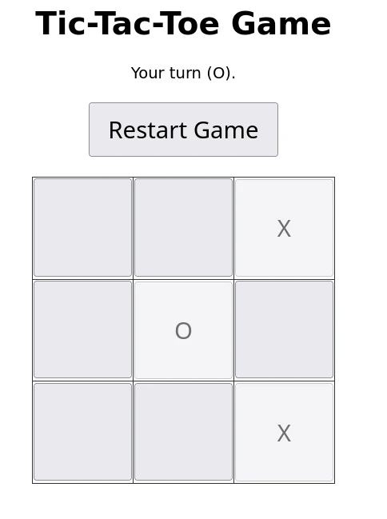

# Tic Tac Toe

## Custom Model

```bash
# Navigate to where you downloaded the Modelfile (replace ~/Downloads if needed)
cd ~/Downloads

# Copy the Modelfile into the container
docker cp Modelfile ollama:/tmp/Modelfile

# Enter the container
docker exec -it ollama bash

# Create your specialized model
cd /tmp
ollama create ttt-ai -f Modelfile

# Verify it was created
ollama list

# Exit container
exit
```

- [Modelfile](Modelfile)

## Client



- [AIClient](./TTT-Client/TTT-Client.html)

Check the Browser Console for the AI's moves.
You can see sometimes the AI will make a mistake and respond with an invalid format.
This is why making AI models part of core game logic is not a good idea.

## Client No AI

Does this app need AI?
No, it is just a simple Tic Tac Toe game.
Here is the same app without AI, just for comparison.
Of course, there are applications where AI would be useful.
But you can see that not every application would benefit from LLMs.

- [TTT-Client-No-AI](./TTT-Client/TTT-Client-No-AI.html)
