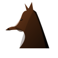

# Vibe Coding a Client

<!-- TODO: Lecture when too quick, Spend more time explaining how you could vibe code responsibly -->
<!-- TODO: Give a demo of adding a feature to a codebase with end to end testing -->

First what is Vibe Coding?

- [The "vibe coding" mind virus explained…](https://www.youtube.com/watch?v=Tw18-4U7mts&t=58s)
- [What is is like to vibe code? Youtube Short](https://www.youtube.com/shorts/ql56K3sveqo)
    - Just show first 2 minutes.

So we write code without looking at the code or even knowing how to code.

Would you trust a doctor who doesn't know what a kidney is? Then why would you trust a developer who doesn't know what a function is?

Anyways lets slop it up.

## Vibe Coding

Use what ever AI you like to complete the following tasks.

### Static Web

Using Vibe Coding to create a static web page.

```
Create a static web page about the history of the banana.
Why is banana candy taste nothing like a banana?
Create this with simple HTML and CSS.
Do not use any JavaScript.
Put all the CSS in a <style> tag in the <head> section.
```

### SVG Horse

SVG is an image from code that describes the image.
They are infinitely scalable.
They are created using editor software not often by hand.

```
Create all the code needed to create a SVG image of a horse.
Make the horse as photorealistic as possible.
Try to keep the line count as low as possible.
Only output the SVG code.
Don't cheat by wrapping an image in an SVG.
```

What I got:



> Don't let the AI cheat. It might just wrap an image in an SVG.

### 3D Racing Game

We can go further by creating a 3D racing game using Vibe Coding.
Now it would be better if we broke down this project into smaller pieces.
Used git to handle version control.
Set up automatic testing.
But for now we will do what they call "one shooting" it.

```
Using three.js create a 3D racing game.
Output this as a single HTML file.
The game should have a car that can be controlled with the arrow keys.
Make the car have to avoid obstacles on the road.
```

- [My 3D Racing Game](./ExampleOutput/3D-Racing-Game.html)
