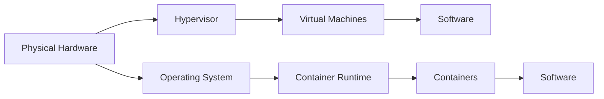

# Containerization

## Containerization != Virtualization

[What is Docker](https://www.youtube.com/watch?v=Gjnup-PuquQ)
[Containers vs VMs: What's the difference?](https://www.youtube.com/watch?v=cjXI-yxqGTI)



Key Difference:

- VMs: Each virtual machine runs its own OS (heavy).
- Containers: Share the host OS kernel but isolate applications (lightweight).

## People don't Ship code to YOUR laptop

When people write code it needs to be deployed on servers.
Not every server is the same.
We need a way to package software that lets it run anywhere

## Docker is not the only Option

* Docker is owned by a private company (Docker, Inc).
* Docker is free as in freedom, not free as in beer.
* Large-scale use often requires a paid license.
* Other container tools exist, like [Podman](https://podman.io/) (FOSS and rootless).
* For this class, we will use Docker since it is the most widely known.

## Install Docker

For servers just download Docker
But for Desktops I recommend Docker desktop (it comes with docker and a nice UI).

- [Download Docker Here](https://www.docker.com/products/docker-desktop/)
    - You DO NOT NEED TO LOG IN

Install directions are in Unit 6 Assignment. 

# Docker Demo 1

- Verify Install
    ```bash
    docker --version
    ```

## Demo: Managing Containers

1. List all containers (even stopped ones)

```bash
docker ps -a
```

2. Run the Hello World container

```bash
docker run hello-world
```

This will:

- Download the `hello-world` image (if not already present).
- Run it once (it exits immediately after printing the message).

3. List containers again

```bash
docker ps -a
```

You should now see the `hello-world` container in the list, **STATUS: Exited**.

4. Stop a container (This will not be `hello-world`)

```bash
docker stop <container_name>
```

> For `hello-world` it will already be stopped since it exits right away.

5. Remove the container

```bash
docker rm <container_id>
```

6. Remove the image itself

```bash
docker rmi hello-world
```

- This is important for space

### 7. Verify cleanup

```bash
docker ps -a       # should show no containers
docker images      # should not list hello-world
```

## Docker Demo 2: Nginx (If we have time)

1. Pull and run Nginx
    ```bash
    docker run -d -p 8080:80 --name mynginx nginx
    ```
    - `-d` runs it in the background (detached).
    - `-p 8080:80` maps port 8080 on your machine → port 80 in the container.
2. Open in a browser
   In web browser go to: [http://localhost:8080](http://localhost:8080)  
   You should see the **"Welcome to nginx!"** default page.
3. Access the container’s filesystem
    ```bash
    docker exec -it mynginx bash
    ```
    - This opens a shell inside the container.
4. Edit the default HTML page
    ```bash
    cd /usr/share/nginx/html
    echo "Hello AI Class" > index.html
    ```
    - This replaces the default Nginx page with your own message.
5. Refresh the browser
    - Go back to [http://localhost:8080](http://localhost:8080)
    - You should now see: **Hello AI Class**
6. Cleanup
    ```bash
    exit # leaves docker container bash and back to host system
    docker stop mynginx
    docker rm mynginx
    docker ps -a # make sure its gone
    ```


