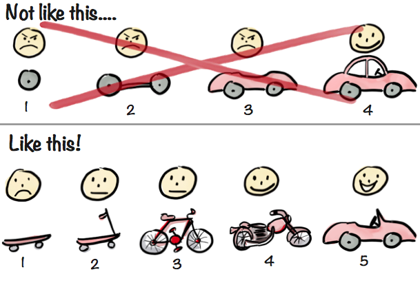
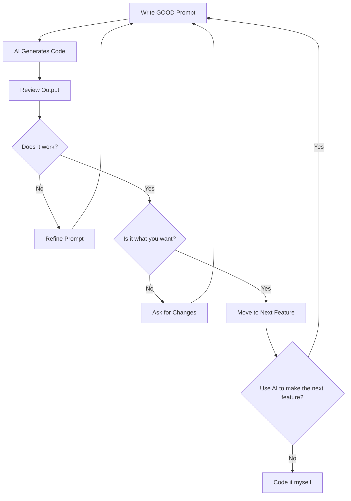

# Svelte Props Developed with AI

This lecture teaches you how to build website that shows off local events.
The focus is on learning **how to effectively prompt AI** to build software, not on learning Svelte syntax in detail.

[//]: # (TODO remove all the extra bold text)

## Prerequisites

- Basic understanding of web development concepts
- Access to an AI coding assistant (like v0, Claude, ChatGPT, etc.)
- Node.js installed on your machine

## How to Develop with AI

- Use an AI IDE
  - Curser
  - Zed
  - VSCode with Co-pilot. 
- Hook up Ollama to this IDE for local AI. 

## The Project

We'll build a simple event page that displays information about "Iowa Tech Summit" including the event name,
description, date, time, and location.

---

## Step 1: Initialize the Project

Prompt to AI:

```
Create a new SvelteKit project with Tailwind CSS. I want a minimal setup for building an event page application.
```

**What to expect:**

- The AI will set up a basic SvelteKit project structure
- Tailwind CSS will be configured
- You'll get a starting point with `src/routes/+page.svelte` and basic configuration files

**Key Learning:** AI **CAN** create the project, but it might be better to do it yourself.

```bash
# create a new project
npx sv create props
# cd into the project directory
cd props
# install dependencies
npm install
# start the development server
npm run dev
```

---

## Step 2: Create the Basic Page Structure

Prompt to AI:

```
Create a simple event page that displays:

- Event name: "Iowa Tech Summit"
- Description: "Connect, Learn and Grow at Iowa's Premier Technology Conference"
- Date: September 15, 2026
- Time: 10:00 AM
- Location: Iowa Event Center

Style it nicely with Tailwind CSS. Make the event name blue and bold.
```

What to expect:

- The AI will create a single page with all the information
- Basic styling will be applied
- Everything will be in one file (src/routes/+page.svelte)

Key Learning: Be specific about the data and styling you want. The AI will make reasonable design decisions.

---

## Step 3: Extract the Header Component

Prompt to AI:

```
Extract the event name into a reusable Header component in src/lib/Header.svelte.
The component should accept an eventName prop with a default value of "Event Name Here".
Keep the blue, bold styling.
```

What to expect:

- A new file `src/lib/Header.svelte` will be created
- The component will use Svelte 5's $props() syntax (AI loves screwing Svelte 5 up).
- The main page will import and use this component

**Key Learning:** Use AI to refactor code into reusable components.

---

## Step 4: Extract the Event Details Component

Prompt to AI:

```
Extract the event details (description, date, time, location) into a reusable EventDetails component in
src/lib/EventDetails.svelte.

The component should accept these props:

- description
- date
- time
- location

Style it as a card with a white background, rounded corners, shadow, and border.
```

**What to expect:**

- A new file `src/lib/EventDetails.svelte` will be created
- The component will accept multiple props
- Nice card styling will be applied
- The main page will be simplified to just import and use both components

**Key Learning:** Break down complex UIs into smaller, manageable components. The AI helps you identify good component
boundaries.

---

## Step 5: Use Props Spreading

Prompt to AI:

```
In the main page (+page.svelte), organize the event data into an object called eventData with properties for
description, date, time, and location. Then use props spreading to pass this data to the EventDetails component.
```

**What to expect:**

- The main page will have cleaner, more organized data
- You'll see the spread operator (`{...eventData}`) in action
- The code becomes more maintainable

**Key Learning:** Ask the AI to show you best practices. Props spreading is a common pattern, and the AI can demonstrate
it.

---

## Step 6: Experiment and Iterate

Now that you have the basic structure, try these prompts to learn more:

- Styling variations
    ```
    Change the event name color from blue to purple and make it larger.
    ```
- Adding features:
  ```
  Add a "Register Now" button to the EventDetails component that opens a mailto link.
  ```
- Responsive design:
    ```
    Make the event details card responsive - full width on mobile, max width of 600px on desktop, centered.
    ```
- Data variations:
    ```
    Add a second event to the page with different details to show how reusable the components are.
    ```

**Key Learning:** Iterate quickly with AI. Try different ideas, ask for variations, and learn by experimenting.

---

## Reflection Questions

After completing this lecture, consider:

1. Do you enjoy developing like this? 
2. Do you think a skilled developer would need to use AI to build an app like this?
3. Do you think you actually learned Svelte while doing this?

---

## Best Practices for AI-Assisted Development

Based on this lecture, here are key takeaways:

1. **Start Simple:** Begin with a basic working version, then iterate. MVP (minimum viable product)
   
2. **Be Specific:** Include exact data, styling preferences, and component/variable names
3. **Refactor Later:** Don't try to build the perfect structure immediately
4. **Understand the Output:** Always read the generated code to learn from it. If you don't want to read the code nobody
   else does.




---

## How I made this lecture (Not to future Self).

1. First I stole my lecture for Web Frameworks.
2. Build this Prompt
    ```
    Using this small project and its notes. I want to make a new lecture for my "Intro to AI" class. I want the lecture to go step by step building the lecture and having the students learn a bit about svelte. But mostly learning AI aided softare development. So work on the README.md and turn this lecture into a step by step lecture on how to build this app with AI. Each step build a prompt you would feed the AI to build the App. Again we are trying to get a mix of Not explaining Svelte too much but focusing on how to develop with "AI". 
    ```
3. Then cleaned it up. 