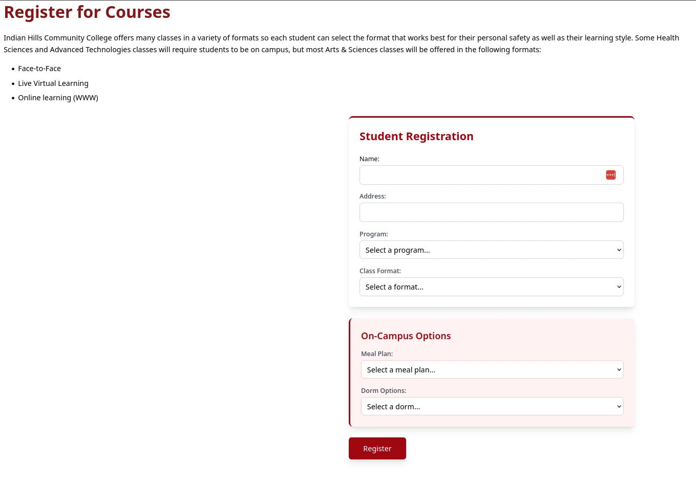

# Svelte Logic with AI

In this lecture, we'll learn how to build a student registration application using AI as your development partner. The
goal is to understand how to effectively prompt AI tools to build software, iterate on designs, and add features
incrementally.

## What We're Building

A student registration form for Indian Hills Community College that includes:

- Course format information display
- Student registration fields (name, address, program selection)
- Conditional on-campus options (meal plans and dorms)
- Responsive design with Tailwind CSS




---

## Step 1: Initialize the Project

Prompt:

```
Create a new SvelteKit project for a student registration form.
Use Tailwind CSS for styling. Set up the basic project structure.
```

What the AI should do:

- Create the SvelteKit minimal template
- Add Tailwind CSS configuration
- Set up the basic file structure

Run the project and see if it works.
Using AI to create the Project is probably a bad idea. Just use these commands if AI can't do it.

```bash
# create a new project
npx sv create register
# cd into the project directory
cd register
# install dependencies
npm install
# start the development server
npm run dev
```

---

## Step 2: Build the Header Component

Prompt:

```
In Svelte 5 Create a header component that displays information about course formats
at Indian Hills Community College. The header should:

- Have a title "Register for Courses"
- Include a paragraph explaining that the college offers classes in various formats
- Display a bulleted list of three formats: "Face-to-Face", "Live Virtual Learning",
  and "Online learning (WWW)"
- Use a red/maroon color scheme (text-red-900 for the title)
- Accept the formats as a prop so they can be passed in

Add this header in a new file called Header.svelte in the src/lib folder.
```

This component/step is static.

---

## Step 3: Create the Registration Form

Prompt:

```
In a seprate file called Form.svelte Create a registration form component with the following fields:

- Name (text input)
- Address (text input)
- Program (dropdown with options: Welding, Computer Software Development,
  Cyber Security, Multimedia Design)
- Class Format (dropdown that uses the same formats from the header)

Style it with:

- A white card with shadow and a red top border
- Red focus rings on inputs
- "Student Registration" as the heading
- Accept programs and formats as props
```

---

## Step 4: Add Conditional On-Campus Options

Prompt:

```
Add a conditional rendering section to the form that shows on-campus options.
This section should:
- Only display when a variable showOnCampusOptions is true
- Have a light red background (bg-red-50) with a left red border
- Include two dropdowns: Meal Plan and Dorm Options
- Meal plans: "Warrior Plan", "Maroon Plan", "Gold Plan"
- Dorm options: "Oak", "Trustee", "Keokuk"
- Have the heading "On-Campus Options"
For now, set showOnCampusOptions to true so we can see it.
```

What you're learning:

- How to request conditional rendering (if statements in Svelte)
- Adding related features to existing components
- Describing layout variations (different background colors)

---

## Step 5: Wire Everything Together

Prompt:

```
In the main page component, import both the Header and Form components.
Set up the data:

- Create a formats array with the three format options
- Create a programs array with objects containing id and name for each program
- Pass these as props to the appropriate components
- Add a Register button at the bottom styled with the red theme
```

Remember: The better you describe what you want, the better the AI can help you build it.
