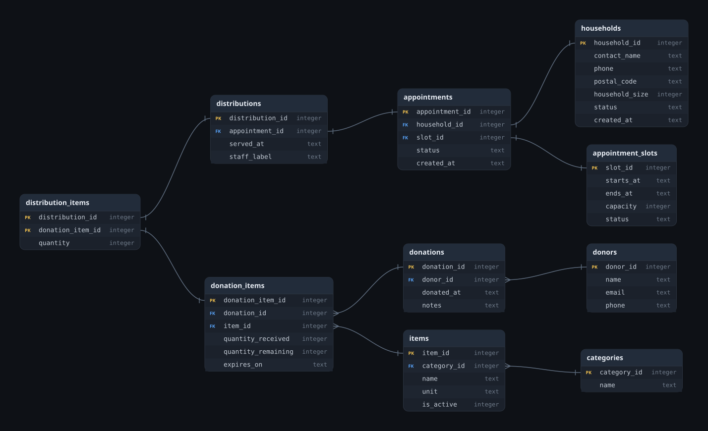

# AI SQL

SQL is a language used to communicate with databases.
It is very efficient and can do many of thousands of operations in a single query.
SQL has been around for decades and is still widely used today.
You can get a job as a data analyst or data scientist and use SQL every day.

- [SQL Explained in 100 Seconds](https://www.youtube.com/watch?v=zsjvFFKOm3c)

## SQLite

We won't have to install anything to play around with SQL, we can use an online SQLite database.

SQLite is one of the coolest pieces of software ever.

- [SQLite](https://sqlite.org/)

## Our Database

First lets see what our data scenario is.
Run the following script to create a database and load it with some data.

-[SQL Seeding Script](./SQL-Seed.sql) 
-[Diagram Tool](https://sqltoerdiagram.com)



> Spoiler I wrote most of the SQL seeding script with AI.

## Querying the Database

Use prompts like these to ask an AI for SQLite queries. Each expected answer is one correct way to write the query.

### 1. Available Inventory

Prompt:

```
Write a SQLite SELECT query that lists each active pantry item with its category, unit, total quantity currently available, and next expiration date. Do not count empty or expired lots, but include items that do not have an expiration date. Sort the results by category and item name.
```

Expected answer:

```sql
SELECT
	categories.name AS category,
	items.name AS item,
	items.unit,
	SUM(donation_items.quantity_remaining) AS quantity_available,
	MIN(CASE
		WHEN donation_items.expires_on IS NOT NULL THEN donation_items.expires_on
	END) AS next_expiration
FROM items
JOIN categories ON categories.category_id = items.category_id
JOIN donation_items ON donation_items.item_id = items.item_id
WHERE items.is_active = 1
  AND donation_items.quantity_remaining > 0
  AND (donation_items.expires_on IS NULL OR donation_items.expires_on >= date('now'))
GROUP BY items.item_id, categories.name, items.name, items.unit
ORDER BY categories.name, items.name;
```

### 2. Trace Donations to Households

Prompt:

```
Write a SQLite SELECT query showing which donor supplied each item that was distributed, which household received it, when it was served, and how many units they received. Show one row per distributed stock lot and household. Sort by service date, donor, and item.
```

Expected answer:

```sql
SELECT
	donors.name AS donor,
	items.name AS item,
	households.contact_name AS household,
	distributions.served_at,
	distribution_items.quantity AS quantity_issued
FROM donors
JOIN donations ON donations.donor_id = donors.donor_id
JOIN donation_items ON donation_items.donation_id = donations.donation_id
JOIN items ON items.item_id = donation_items.item_id
JOIN distribution_items ON distribution_items.donation_item_id = donation_items.donation_item_id
JOIN distributions ON distributions.distribution_id = distribution_items.distribution_id
JOIN appointments ON appointments.appointment_id = distributions.appointment_id
JOIN households ON households.household_id = appointments.household_id
ORDER BY distributions.served_at, donors.name, items.name, households.contact_name;
```

### 3. Household Visit History

Prompt:

```
Write a SQLite SELECT query showing every household and the number of completed food distributions they received in each calendar month. Include households that have never received a distribution, and do not count cancelled or no-show appointments. Sort by household name and month.
```

Expected answer:

```sql
WITH monthly_visits AS (
	SELECT
		appointments.household_id,
		strftime('%Y-%m', distributions.served_at) AS service_month,
		COUNT(*) AS completed_visits
	FROM appointments
	JOIN distributions ON distributions.appointment_id = appointments.appointment_id
	GROUP BY
		appointments.household_id,
		strftime('%Y-%m', distributions.served_at)
)
SELECT
	households.household_id,
	households.contact_name,
	monthly_visits.service_month,
	COALESCE(monthly_visits.completed_visits, 0) AS completed_visits
FROM households
LEFT JOIN monthly_visits
	ON monthly_visits.household_id = households.household_id
ORDER BY households.contact_name, monthly_visits.service_month;
```

### 4. Upcoming Appointment Capacity

Prompt:

```
Write a SQLite SELECT query listing every future appointment slot that is open for booking. Show its start time, capacity, number of confirmed appointments, and remaining seats. Cancelled appointments and no-shows should not use a seat. Keep open slots in the results even if they have no bookings, and sort by start time.
```

Expected answer:

```sql
SELECT
	appointment_slots.slot_id,
	appointment_slots.starts_at,
	appointment_slots.capacity,
	COUNT(appointments.appointment_id) AS confirmed_appointments,
	MAX(appointment_slots.capacity - COUNT(appointments.appointment_id), 0) AS seats_remaining
FROM appointment_slots
LEFT JOIN appointments
	ON appointments.slot_id = appointment_slots.slot_id
   AND appointments.status = 'confirmed'
WHERE appointment_slots.status = 'open'
  AND julianday(appointment_slots.starts_at) > julianday('now')
GROUP BY
	appointment_slots.slot_id,
	appointment_slots.starts_at,
	appointment_slots.capacity
ORDER BY appointment_slots.starts_at;
```

### 5. Distribution Totals by Month

Prompt:

```
Write a SQLite SELECT query that reports the total quantity distributed for each item in each calendar month, along with the item's category. Only include items that were actually distributed. Sort newest month first, then by category and item name.
```

Expected answer:

```sql
SELECT
	strftime('%Y-%m', distributions.served_at) AS service_month,
	categories.name AS category,
	items.name AS item,
	SUM(distribution_items.quantity) AS quantity_distributed
FROM distributions
JOIN distribution_items
	ON distribution_items.distribution_id = distributions.distribution_id
JOIN donation_items
	ON donation_items.donation_item_id = distribution_items.donation_item_id
JOIN items ON items.item_id = donation_items.item_id
JOIN categories ON categories.category_id = items.category_id
GROUP BY
	strftime('%Y-%m', distributions.served_at),
	categories.name,
	items.name
ORDER BY service_month DESC, categories.name, items.name;
```

## Full Stack App using our DB

This might be a bit much to cram in one lecture.
So maybe just show students the app running.

```bash
python --version
python -m venv .venv
```

Activate the virtual environment. Use the commands for your operating system:

```bash
# macOS or Linux
source .venv/bin/activate
```

```powershell
# Windows PowerShell
.\.venv\Scripts\Activate.ps1
```

Activate the environment using the macOS/Linux or Windows PowerShell command above, then install dependencies and start the app:

```bash
python -m pip install -r requirements.txt
python -m flask --app app run --debug
```

Open [`http://127.0.0.1:5000`](http://127.0.0.1:5000) in a browser. The `--debug` option is for local classroom development only, not deployment.

> Spoiler: I wrote most of the Flask app with AI.
