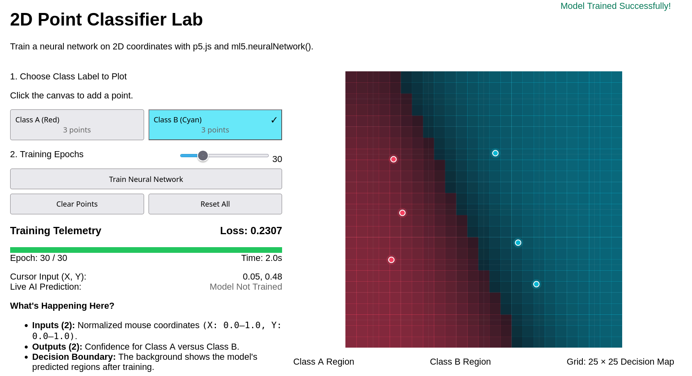

# TensorFlow

- [TensorFlow](https://www.tensorflow.org/)
- [ml5.js](https://ml5js.org/)

## TensorFlow

- [TensorFlow in 100 Seconds](https://www.youtube.com/watch?v=i8NETqtGHms)
- [Google Pixel SOC](https://en.wikipedia.org/wiki/Google_Tensor) is called Google Tensor, which is a custom-designed system on a chip (SoC) named after the TensorFlow machine learning framework. It is designed to accelerate machine learning workloads on mobile devices, enabling faster and more efficient processing of AI tasks.

We’ll use ml5.js to build and explore simple machine-learning models. These models share basic ideas with LLMs—such as learning patterns from examples—but LLMs use different architectures and are trained with far more data and computing power.

## Honey what is a Neural Network?

- [IBM Neural Network](https://www.youtube.com/watch?v=jmmW0F0biz0)

## Online Demo

- [TensorFlow Playground](https://playground.tensorflow.org/)
- [Emoji Scavenger Hunt](https://archive.google/emojiscavengerhunt/)

## Custom Demo

- [2D Point Classifier](2d_point_classifier_ml5_js.html)

