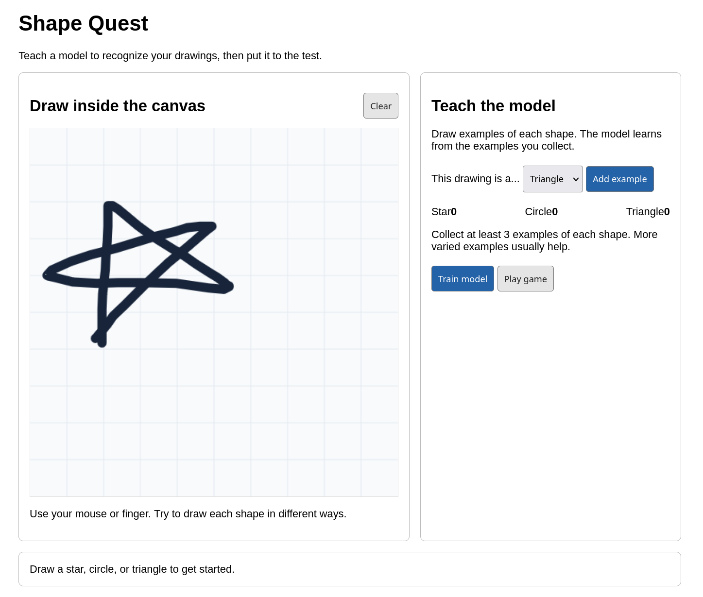

# Shape Quest

Shape Quest is a small browser game built with [p5.js](https://p5js.org/) and [ml5.js](https://ml5js.org/).
Players draw examples of stars, circles, and triangles, train a classifier on their drawings.
Then the player draws a new shape and the model predicts what it is.

