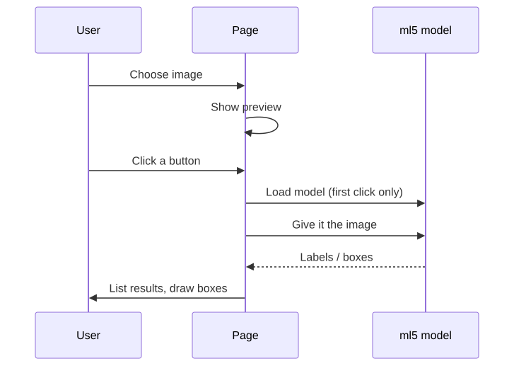

# Image Classification and Object Detection

Made by Luke Matheis

---

## Pre-trained models

In previous lessons, we trained our own model from a few examples. Here we reuse models that
were already trained on millions of labeled images.

---

## Pre-trained models

- No training data or training step is needed on our side.
- The model only knows the categories it was trained on.
- **ml5.js** is the beginner-friendly library we use to load these models
  (same library as before).
- Under the hood it uses **TensorFlow.js**, Google's engine for running models
  in the browser, so the image is never uploaded to a server.

---

### Two vision tasks, one image

- **Image classification:** give the whole image one or more labels.
- **Object detection:** find each object and draw a box around it.

---

### Two vision tasks, one image

|                 | Classification         | Detection                         |
| --------------- | ---------------------- | --------------------------------- |
| Question        | What is in this image? | What objects are here, and where? |
| Output          | Ranked labels          | Label + box (x, y, width, height) |
| Cannot tell you | Where things are       | Whether the label is true         |

---

### The two models in the example

Each model is trained on a dataset, and the dataset decides what it can name.

|            | Classifier                                                                      | Detector                                                                                                |
| ---------- | ------------------------------------------------------------------------------- | ------------------------------------------------------------------------------------------------------- |
| Model      | **MobileNet**: a small, fast network built for phones and browsers              | **COCO-SSD**: a detector that finds many objects in one pass                                            |
| Trained on | **ImageNet**: over a million photos, each labeled with one of ~1,000 categories | **COCO**: photos with boxes drawn around objects from 80 everyday categories (person, cup, dog, car...) |

---

### Confidence

- Each classification label comes with a confidence from 0 to 1.
- Confidence is the model's score, **not** the probability that it is correct.
- A model must always pick something, so an unfamiliar image still gets labels.

---

### Bounding boxes

- A **canvas** is an HTML element we can draw on; it sits on top of the image.
- Coordinates are relative to the original image, so the canvas is sized to match.

---

### Why models fail

- Objects outside the training categories (a model cannot name what it never saw).
- Small, cluttered, blurry, or partly hidden objects.
- Unusual angles or lighting.
- Bias in the training data.

---

## The Example Flow

---

## Resources

- [ml5.js ImageClassifier](https://docs.ml5js.org/#/reference/image-classifier)
- [ml5.js ObjectDetection](https://docs.ml5js.org/#/reference/object-detection)
- [MobileNet (TensorFlow.js models)](https://github.com/tensorflow/tfjs-models/tree/master/mobilenet)
- [COCO-SSD (TensorFlow.js models)](https://github.com/tensorflow/tfjs-models/tree/master/coco-ssd)
- [ImageNet dataset](https://image-net.org/)
- [COCO dataset](https://cocodataset.org/)
